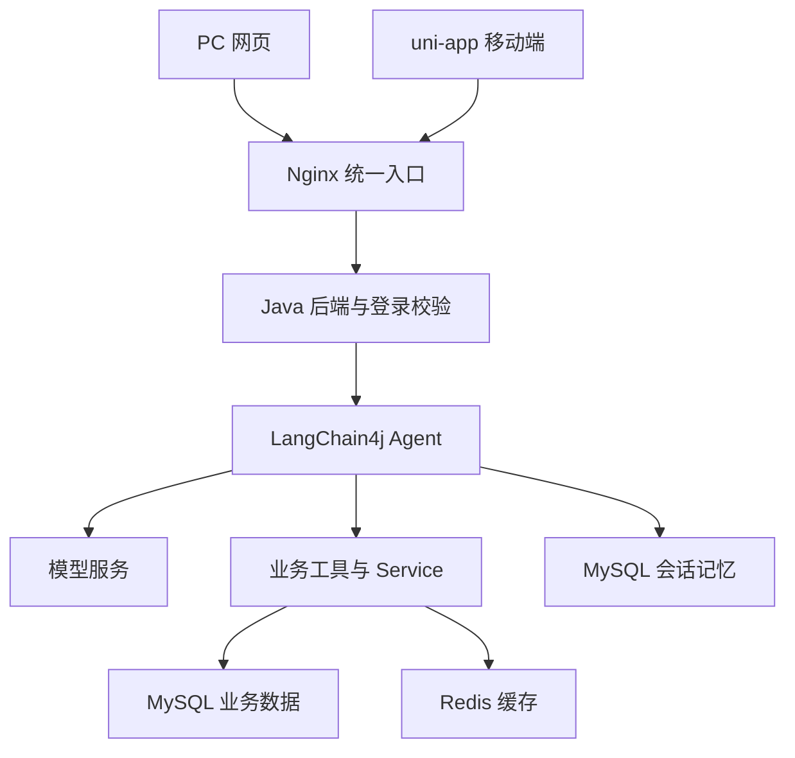

# Agent销售系统分析

**基于 Java、LangChain4j 与 Vue 的销售数据分析 Agent，让查询业绩、分析趋势和生成图表在一次对话中完成。**

项目面向销售人员与管理者，通过自然语言调用销售查询、汇总、趋势、图表和异常检测工具，结合 MySQL 业务数据返回分析结果。提供 PC 网页及 uni-app 移动端源码，并附 Docker Compose 配置，适合学习、功能演示和二次开发。

## 可以用它做什么

| 场景 | 示例问题 | 对应能力 |
|---|---|---|
| 业绩查询 | 本月销售情况怎么样？ | 按日期、区域和人员查询订单 |
| 排行比较 | 最近销售额最高的产品有哪些？ | 产品、区域与销售人员排行 |
| 趋势分析 | 最近 6 个月的销售走势是什么？ | 月度趋势、同比和环比分析 |
| 数据可视化 | 帮我把销售趋势画成折线图 | 结构化图表数据与前端渲染 |
| 异常发现 | 当前销售数据有哪些异常？ | 调用规则化的异常检测工具 |
| 连续追问 | 再比较一下各区域的表现 | 会话记忆与上下文追问 |

业务数据来自数据库查询，模型负责理解问题、选择工具及组织解释。项目没有训练预测模型，不把回答当作未来销售预测或经营决策保证。

## 功能模块

- **销售分析 Agent**：LangChain4j `AiServices` 组织普通与流式模型调用，注册五类业务工具，记录工具执行过程。
- **数据查询与统计**：通过 Service 和 Repository 查询订单、销售人员、区域与产品，完成排行和时间维度分析。
- **对话记忆**：MySQL 持久化会话内容，使用最多 20 条消息的窗口记忆，并支持清除会话。
- **Redis 缓存**：销售排行、区域排行、月度趋势、区域元数据等使用不同缓存时间，减少重复查询。
- **身份与角色上下文**：Sa-Token 登录，维护员工角色、区域和身份信息；部分查询使用用户上下文限制范围。完整的数据权限仍需按业务场景测试。
- **PC 网页**：登录、快捷问题、历史会话、流式回答、Markdown 内容和 ECharts 图表。
- **移动端**：uni-app 登录、聊天、会话搜索与删除、个人页、服务器设置，以及折线图、柱状图、饼图和数据表。
- **可观测性**：模型 Token 使用计数、工具日志与 Actuator 健康检查；费用日志中的单价仅为代码内示例。

## 技术栈

| 分类 | 技术 |
|---|---|
| 后端 | Java 21、Spring Boot 3.5.11、Maven |
| AI 应用 | LangChain4j 1.12.1、Tool Calling、OpenAI 兼容接口 |
| 数据与缓存 | MySQL、Spring Data JPA、Redis、Spring Cache |
| 认证与校验 | Sa-Token 1.39.0、Jakarta Validation |
| PC 前端 | Vue 3、Vite、Pinia、Vue Router、Element Plus |
| 内容与图表 | ECharts、vue-echarts、markdown-it、highlight.js |
| 移动端 | uni-app、Vue 3、uni.request、Canvas |
| 运行与发布 | Docker、Docker Compose、Nginx |

## 架构与执行过程



前端发出问题后，后端接收会话 ID 与消息，模型根据上下文决定是否调用业务工具。工具返回查询结果或 `CHART_JSON:` 图表配置，模型将其组织成回答，前端再呈现文字与图表。PC 已编写 SSE 接入；移动端第一版使用普通响应接口，暂不逐字输出。

## 项目优点

1. **AI 与业务查询结合**：围绕查询、排行、趋势和异常设计工具，形成可演示的销售分析流程。
2. **计算逻辑便于维护**：业务统计由 Java 工具和数据库承接，模型负责调用与解释，避免把全部规则塞进提示词。
3. **多轮分析与可视化**：对话记忆支持连续提问，结构化图表配置把分析结果转化为可读的图表。
4. **考虑重复请求成本**：Redis 按场景缓存常用查询，提供 Token 计数与工具日志，便于后续观察和优化。未宣称未经测量的性能提升。
5. **一套后端支持多个入口**：PC 与移动端共用业务接口，分别采用适合屏幕大小的页面布局。
6. **配置与源码分离**：密钥和连接信息通过环境变量注入；容器方案仅开放网页入口，便于下载者准备独立演示环境。

## 目录结构

```text
agent-sales-analysis/
  jc-sales-agent/                 Java 后端
    src/main/java/.../
      agent/                     Agent 定义与工具编排
      controller/                登录、普通和流式对话接口
      service/                   查询与统计逻辑
      tool/                      五类业务工具
      repository/                数据访问
      memory/                    对话记忆存储
      security/                  用户上下文与参数校验
      config/                    缓存、认证与日志配置
    src/main/resources/db/       建表及动态日期演示数据
  jc-sales-agent-front/           PC 网页
  jc-sales-agent-uniapp/          微信小程序、App 与 H5 源码
  deploy/                        Dockerfile 与 Nginx 配置
  docs/                          部署和配置说明
  scripts/                       发布文件与敏感信息检查
  compose.yaml                   MySQL、Redis、后端与网页编排
  .env.example                   运行配置示例
```

## Docker 启动

安装并启动 Docker Desktop，或使用 Docker Engine + Compose。在项目根目录执行：

```powershell
Copy-Item .env.example .env
```

编辑 `.env`，填写自己的 `MYSQL_PASSWORD`、`MYSQL_ROOT_PASSWORD`、`REDIS_PASSWORD` 和 `AI_API_KEY`。模型服务地址和名称可按自己的 OpenAI 兼容模型调整。然后执行：

```powershell
docker compose config --quiet
docker compose up -d --build
docker compose ps
```

| 页面 | 默认访问地址 |
|---|---|
| PC 网页 | http://localhost:8080 |
| 手机布局 H5 | http://localhost:8081 |

首次构建需联网下载镜像与依赖。Compose 会等待 MySQL、Redis 和后端的健康检查，再启动依赖服务。数据库脚本只由 MySQL 在新数据卷首次初始化时执行；后端重启不会重复清空演示数据。

登录使用已有的演示员工 ID，例如 `1`（经理）、`2`（销售代表）、`13`（总监），具体角色以初始化 SQL 为准。订单日期按 `CURDATE()` 动态生成，适合不同时间运行演示。

**当前登录属于演示方案：输入员工 ID 即可登录，未接入密码登录或微信授权。** 默认只监听本机地址；开放给公网访问前，需要完善实际身份验证、会话归属校验与工具级数据权限。

查看日志和停止服务：

```powershell
docker compose logs --tail=100 backend
docker compose stop
```

详细说明见 [部署与配置](docs/DEPLOYMENT.md)。

## 本地开发与多端运行

| 部分 | 启动方式 |
|---|---|
| Java | 准备 Java 21、MySQL、Redis 和模型配置，在后端目录运行 `mvn spring-boot:run` |
| PC | 在 PC 目录运行 `npm install`、`npm run dev`，默认端口 5173 |
| 移动 H5 | 在 uni-app 目录运行 `npm install`、`npm run dev:h5`，默认端口 5174 |
| 微信小程序 | 配置自己的微信 AppID，运行 `npm run dev:mp-weixin`，开发者工具导入 `dist/dev/mp-weixin` |
| 手机 App | HBuilderX 导入 uni-app 工程，配置 DCloud AppID 后运行到真机；正式安装包另需签名与打包 |

本地后端默认不初始化数据库。先执行 `db/schema.sql` 和 `db/data.sql`，或使用 Docker 初始化新数据库。`data.sql` 含清理语句，仅用于可丢弃的演示数据，不要对真实业务库执行。

## 发布边界与验证情况

- 真实配置保存在被忽略的 `application-local.yml` 或 `.env`，不会作为发布文件上传；Docker 构建也排除本地配置。
- 后端、MySQL 和 Redis 不映射宿主机端口。Nginx 只代理前端必需接口，不公开工具调试及 Actuator 入口。
- 浏览器调用的接口和开源代码仍可查看。凭据保护与身份验证是安全措施，不能依靠隐藏接口名称。
- 移动端 11 项逻辑与模拟接口测试通过，8 个 Vue 文件通过语法编译检查。
- `docker compose config --quiet` 已通过，模型、数据库和 Redis 配置键已与源码对应。
- 本次 PC 构建受本机依赖文件访问权限阻挡；Java 离线打包受 Maven 插件缓存缺失阻挡。uni-app 完整构建、真实模型联调和手机真机仍需验证；当前环境无法访问 Docker 引擎，未完成整栈启动测试。发布源码不代表已经上线运行。

项目基于销售 Agent 课程实践持续扩展，适合学习与展示。欢迎在自己的环境中验证后继续完善身份认证、权限测试和多端体验。
